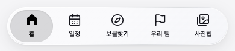
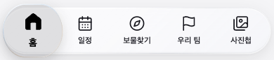
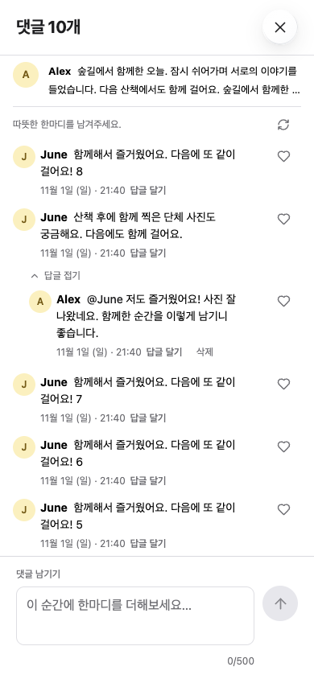

# 일상 밖으로 디자인 시스템

## Overview

**콘텐츠는 선명하게, 탐색 컨트롤은 가볍게 떠 있도록.**

2026-11-01까지 적용한 최종 기준이다. 일정·보물찾기·팀·사진을 확인하는 모바일 우선 PWA이며, 기존 정보 구조와 메뉴 순서를 유지한다. 본문은 밝은 회색과 불투명 흰색, 주요 동작은 웜 옐로우와 차콜을 사용한다. 유리 재질은 탐색·조작 영역에 한정한다.

하단 탭의 **정지 상태는 바 안쪽에 들어간 평평한 회색 면과 채움형 아이콘**이다. 누르거나 드래그할 때는 볼록한 렌즈가 떠오르고 그 안의 아이콘·글자가 확대된다. 정지 상태와 누름 상태의 깊이를 서로 바꾸지 않는다.

| 기준 파일                                             | 역할                                         |
| ----------------------------------------------------- | -------------------------------------------- |
| [tokens.css](src/design/tokens.css)                   | 색·타입·간격·크기·재질·그림자의 단일 원본    |
| [motion-tokens.ts](src/design/motion-tokens.ts)       | 탭 렌즈·사진 뷰어의 모션과 제스처 수치 원본  |
| [primitives.css](src/design/primitives.css)           | 버튼·입력·유리·하단 탭의 공통 구현           |
| [styles.css](src/styles.css)                          | 화면별 배치, 반응형 규칙, 컴포넌트 세부 구현 |
| [.impeccable/design.json](.impeccable/design.json)    | 문서 도구용 메타데이터와 독립 HTML/CSS 예제  |
| [현재 모바일 홈](docs/design/current-home-mobile.png) | 전체 화면의 최신 색상·타입·탐색 구성         |
| [현재 하단 탭](docs/design/current-navigation.png)    | 최종 선택 면·채움형 아이콘의 시각 기준       |
| [현재 댓글창](docs/design/current-comments.png)       | 최종 댓글 밀도와 하단 입력창의 시각 기준     |

CSS와 TypeScript 토큰이 규범적 원본이고, 아래 표는 사용법을 설명한다. frontmatter는 식별 정보만 담는다. 초기 [모바일 시안](docs/design/mobile-approved.png)은 배치·방향을 정한 기록이며, 최신 색상·선택 상태·댓글 밀도는 현재 코드와 이 문서가 우선한다. 문서 이미지에는 로컬 예시 데이터를 사용한다.



유지할 구조:

- 홈의 인사말 → 배너 → 일정 → 보물찾기 → 공지 → 탐험 여권 → 팀 카드 순서.
- 모바일 하단의 **홈 / 일정 / 보물찾기 / 우리 팀 / 사진첩** 다섯 항목. 소식은 상단 알림과 전체 메뉴로 접근한다.
- 데스크톱 사이드바와 기존 콘텐츠 열 배치.
- `ExpeditionArt`의 일러스트, 실제 사진·보물 이미지·지도, 데이터와 기능·권한의 의미.

밝은 앱이 기준이다. 사진 전체화면 뷰어만 독립 차콜 표면을 사용하며, 이를 앱 전체의 다크 테마로 간주하지 않는다.

## Colors

| 역할                                    | 토큰                                                                                                           | 기본값                                                                |
| --------------------------------------- | -------------------------------------------------------------------------------------------------------------- | --------------------------------------------------------------------- |
| 앱 바탕 / 콘텐츠 표면                   | `--ds-color-canvas` / `--ds-color-surface`                                                                     | `#F5F5F7` / `#FFFFFF`                                                 |
| 보조 표면                               | `--ds-color-surface-subtle`                                                                                    | `#EEEEF1`                                                             |
| 일반 제목·본문 / 보조 글자              | `--ds-color-text` / `--ds-color-text-secondary`                                                                | `#1D1D1F` / `#6E6E73`                                                 |
| 사진 게시자·본문·댓글                   | `--ds-color-photo-content`                                                                                     | `#000000`                                                             |
| 주요 버튼 배경 / 라벨                   | `--ds-color-action` / `--ds-color-on-action`                                                                   | `#F5D547` / `#1D1D1F`                                                 |
| 버튼 hover / pressed                    | `--ds-color-action-hover` / `--ds-color-action-pressed`                                                        | `#E8C632` / `#D8B624`                                                 |
| 링크·선택 글자 / hover                  | `--ds-color-action-text` / `--ds-color-action-text-hover`                                                      | `#1D1D1F` / `#51420F`                                                 |
| 보물·보상 포인트                        | `--ds-color-accent`                                                                                            | `#F5D547`                                                             |
| 본문 선택 표면                          | `--ds-color-selected`                                                                                          | `#FFF3BF`                                                             |
| 지도 내 위치·방향                       | `--ds-color-location`                                                                                          | `#007AFF`                                                             |
| 위치 후광                               | `--ds-color-location-halo`                                                                                     | 위치 색 18%                                                           |
| 성공 / 배경                             | `--ds-color-success` / `--ds-color-success-bg`                                                                 | `#237647` / `#EAF5ED`                                                 |
| 경고 / 오류                             | `--ds-color-warning` / `--ds-color-danger`                                                                     | `#805500` / `#B42318`                                                 |
| 구분선 / 일반 테두리 / 입력 경계        | `--ds-color-separator` / `--ds-color-border` / `--ds-color-border-input`                                       | `#DEDEE3` / `#D9D9DF` / `#86868B`                                     |
| 키보드 포커스                           | `--ds-color-focus`                                                                                             | `#756000`                                                             |
| 유리 위 기본 글자                       | `--ds-glass-text`                                                                                              | `#14141B`                                                             |
| 하단 선택 배경 / 불투명 대체            | `--ds-glass-selected-bg` / `--ds-glass-selected-opaque`                                                        | `rgb(80 80 86 / 20%)` / `#D8D8DA`                                     |
| 선택 아이콘·라벨                        | `--ds-glass-selected-text`                                                                                     | `#000000`                                                             |
| 누름 렌즈 배경                          | `--ds-tab-lens-bg`                                                                                             | `rgb(80 80 86 / 16%)`                                                 |
| 사진 뷰어 바탕 / 글자                   | `--ds-photo-viewer-bg` / `--ds-photo-viewer-text`                                                              | `#1D1D1F` / `#FFFFFF`                                                 |
| 사진 뷰어 보조 글자                     | `--ds-photo-viewer-text-secondary`                                                                             | `#D2D2D7`                                                             |
| 사진 뷰어 컨트롤 기본 / hover / pressed | `--ds-photo-viewer-control-bg` / `--ds-photo-viewer-control-bg-hover` / `--ds-photo-viewer-control-bg-pressed` | `rgb(36 36 38 / 64%)` / `rgb(60 60 64 / 82%)` / `rgb(80 80 84 / 90%)` |

### 역할 구분

옐로우는 주요 동작·보물 포인트, 회색은 하단 선택 상태, 파랑은 지도 내 위치, 초록은 방향 일치·성공이다. 지도 위치 점·방향 화살표·GPS 오차 원·범례·관리자 배치 지도의 내 위치는 같은 위치 토큰을 쓴다. SDK 도형에는 계산된 CSS 색상을 전달한다.

버튼 배경과 링크 글자를 분리한다. 밝은 노란 글자를 흰 표면에 놓지 않는다. 삭제 버튼과 성공 체크의 흰 라벨은 각각 `--ds-color-on-danger`, `--ds-color-on-success`를 사용한다. 좋아요 하트, 팀 색과 기존 일러스트의 색은 해당 콘텐츠의 의미를 유지한다.

차콜 라벨과 기본 옐로우 버튼 대비는 11.61:1, 누른 버튼은 8.52:1이다. 이는 불투명 sRGB 조합의 계산값이다. 유리 위 글자는 실제 지도·사진 배경에서도 확인한다. 색과 함께 아이콘·문구·형태로 상태를 표시한다.

## Typography

Apple 기기에서는 시스템 UI 글꼴을, 다른 환경에서는 기존 Noto Sans KR을 사용한다. SF 글꼴 파일을 임의로 번들에 추가하지 않는다. Jua는 `ExpeditionArt`의 그림 속 글자에만 남긴다.

```css
font-family: var(--ds-font-ui);
/* -apple-system, BlinkMacSystemFont, "Apple SD Gothic Neo",
   "Noto Sans KR", "Segoe UI", sans-serif */
```

| 역할                  | 토큰                                                             | 크기 / 굵기 / 행간                  |
| --------------------- | ---------------------------------------------------------------- | ----------------------------------- |
| 홈 배너               | `--ds-font-size-hero` / `--ds-font-size-hero-desktop`            | 40 / 48px, 700, 1.15                |
| 기본 페이지 제목      | `--ds-font-size-page`                                            | 24px, 700, 1.3                      |
| 섹션 / 카드 제목      | `--ds-font-size-section` / `--ds-font-size-title`                | 20 / 18px, 600–700, 1.3             |
| 기본 본문·주요 버튼   | `--ds-font-size-body`                                            | 15px, 400 / 600                     |
| 입력                  | `--ds-font-size-input`                                           | 16px, 400                           |
| 일반 라벨 / 메타      | `--ds-font-size-label` / `--ds-font-size-caption`                | 13 / 12px                           |
| 하단 탭               | `--ds-font-size-tab`                                             | 11px, 기본 500 / 선택·렌즈 700, 1.4 |
| 사진첩 제목           | `--ds-photo-title-size` / `--ds-photo-title-size-mobile`         | 2.5rem / 2.1rem, 700, 1.25          |
| 사진 게시자·본문·댓글 | `--ds-photo-body-size`                                           | 1rem, 게시자 700 / 본문 400         |
| 피드 댓글 미리보기    | `--ds-photo-comment-preview-size`                                | 0.93rem, 약 13px                    |
| 사진 본문 / 댓글 행간 | `--ds-photo-post-line-height` / `--ds-photo-comment-line-height` | 1.6 / 1.5                           |

현재 루트 글자 크기는 14px이므로 사진 본문 1rem은 14px이다. 사용자 확대를 제한하지 않으며 긴 이름·본문은 줄바꿈한다. 사진 미리보기만 최대 두 줄이고 댓글창 본문은 전체를 표시한다.

제목 자간은 기본 `--ds-letter-spacing-heading`(-0.025em), 본문은 -0.01em이다. 시간·거리·점수는 tabular numerals를 사용한다. 기존 영문 보조 표기는 유지하되 새 화면마다 장식용 소제목을 추가하지 않는다.

## Layout

기존 반응형 구조를 유지한다. 대표 검수 폭은 320·390·430·768·1024·1440px이다.

| 구간        | 배치                                   |
| ----------- | -------------------------------------- |
| ≤760px      | 모바일 본문 좌우 20px, 떠 있는 하단 탭 |
| 761–1000px  | 사이드바 185px                         |
| 1001–1190px | 사이드바 205px                         |
| ≥1191px     | 사이드바 232px, 기존 데스크톱 열 배치  |
| ≥1500px     | 기존 넓은 화면 조정                    |

CSS 변수는 일반 미디어 쿼리 조건에 직접 넣지 않는다. 실제 분기는 `styles.css`와 `primitives.css`에 유지한다.

### 공통 간격과 탐색 영역

- 기본 간격 스케일: 2 / 4 / 6 / 8 / 12 / 16 / 20 / 24 / 32 / 40 / 48 / 64px.
- 기본 터치 영역은 `--ds-size-touch` 44px, 탭은 최소 54px, 하단 바는 최소 64px이다.
- 하단 바 좌우 12px, 아래 10px + safe area, 최대 폭 480px. 전체 폭 배경 띠를 추가하지 않는다.
- `useNavigationInsets`가 실제 상단·하단 높이를 측정한다. 본문의 하단 여유와 scroll-padding은 측정값·safe area를 반영한다.
- 데스크톱에서는 하단 바를 숨기고 사이드바를 사용한다.

### 사진·댓글 밀도

| 용도                                    | 토큰                                                                         | 값             |
| --------------------------------------- | ---------------------------------------------------------------------------- | -------------- |
| 데스크톱 피드 최대 폭                   | `--ds-photo-feed-max-width`                                                  | 600px          |
| 게시글 간격 기본 / 모바일               | `--ds-photo-feed-gap` / `--ds-photo-feed-gap-mobile`                         | 8 / 4px        |
| 게시글 하단 여유                        | `--ds-photo-post-padding-bottom`                                             | 12px           |
| 작성자 헤더 세로 여백 기본 / 모바일     | `--ds-photo-header-padding-block` / `--ds-photo-header-padding-block-mobile` | 8 / 6px        |
| 모바일 헤더·본문 좌우 여백              | `--ds-photo-gutter-mobile`                                                   | 12px           |
| 댓글 보조 버튼 최소 높이 / 폭           | `--ds-photo-comment-control-height` / `--ds-photo-comment-control-width`     | 28 / 44px      |
| 댓글 아바타                             | `--ds-photo-comment-avatar-size`                                             | 28px           |
| 댓글·답글 항목 세로 여백                | `--ds-photo-comment-padding-block`                                           | 4px            |
| 댓글 본문·메타 가로 간격                | `--ds-photo-comment-gap`                                                     | 6px            |
| 댓글 대화 영역 좌우 여백                | `--ds-photo-comment-gutter`                                                  | 16px           |
| 미리보기 세로 padding / 줄 수           | `--ds-photo-comment-preview-padding` / `--ds-photo-comment-preview-lines`    | 2px / 최대 2줄 |
| 답글 들여쓰기 기본 / 좁은 화면·미리보기 | `--ds-photo-reply-indent` / `--ds-photo-reply-indent-compact`                | 20 / 16px      |

**28px는 댓글 보조 동작의 밀도 예외다.** 본문 미리보기·하트·좋아요 수·답글·삭제·답글 펼치기에 적용한다. 닫기·사진 이동·댓글 게시·삭제 확인 등 주요 조작은 44px을 유지한다. 짧은 미리보기는 한 행 28px이고, 긴 댓글은 내용에 맞춰 높아진다.

## Elevation & Depth

본문은 불투명하고 평평하게, 탐색 컨트롤은 콘텐츠 위에 떠 있게 한다. 하단의 **정지 선택 면**과 **누름 렌즈**는 깊이가 다른 두 상태다.

| 대상                                              | 재질·깊이                                                                   |
| ------------------------------------------------- | --------------------------------------------------------------------------- |
| 본문 카드·폼·배지                                 | 불투명 표면, 기본 그림자 없음                                               |
| 상단 원형 메뉴·알림/프로필 그룹·하단 바·지도 도구 | 흰색 50%, blur 10px, saturate 1.65, 얇은 반사 가장자리                      |
| 정지한 선택 탭                                    | 회색 20%, `inset 0 1px 2px rgb(29 29 31 / 12%)`, 바깥 그림자·상단 광택 없음 |
| 누름·드래그 렌즈                                  | 회색 16%, 떠오르는 그림자와 얇은 광학 가장자리, 내부 아이콘 확대            |
| 팝오버                                            | `--ds-shadow-popover`: 0 8px 28px, 검정 계열 14%                            |
| 일반 모달                                         | `--ds-shadow-modal`: 0 16px 48px, 검정 계열 18%                             |
| 사진 전체화면                                     | 차콜 바탕, 원비율 사진, 필요한 조작 도구만 유리                             |

재질의 실제 값은 `--ds-glass-*`, `--ds-tab-lens-*`, `--ds-shadow-*`에 있다. 유리 그룹 안에 blur를 여러 겹 중첩하지 않는다. 상단 바 전체에 불투명 배경을 덧대어 작은 유리 컨트롤의 배경 샘플링을 막지 않는다.

### 하단 탭 모션

`motion-tokens.ts`의 `liquidTabMotionTokens`를 `MobileTabBar`와 `advanceLiquidTab`이 함께 사용한다. 화면 이동은 손을 놓을 때 가장 가까운 탭으로 한 번만 실행한다.

| 모션 토큰                                                       | 값                                                                    | 역할                          |
| --------------------------------------------------------------- | --------------------------------------------------------------------- | ----------------------------- |
| `follow`                                                        | stiffness 1800 / damping 70                                           | 손가락 추종                   |
| `settle`                                                        | 620 / 42                                                              | 놓은 뒤 위치 안착             |
| `lift`                                                          | 800 / 48                                                              | 누름 높이·복원                |
| `railExpansion`                                                 | 0.04                                                                  | 바 최대 4% 확장               |
| `contentMagnification`                                          | 0.22                                                                  | 렌즈 안의 내용 약 22% 확대    |
| `lensWidthExpansion` / `lensHeightExpansion`                    | 0.16 / 0.38                                                           | 정지한 누름 렌즈의 비율 변화  |
| `maxVelocityStretch`                                            | 0.14                                                                  | 이동 중 추가 가로 늘어남 상한 |
| `velocityStretchScale` / `stretchCompression` / `shapeResponse` | 3200 / 0.65 / 30                                                      | 속도에 따른 변형·복원         |
| `gesture`                                                       | 가로 시작 6px / 세로 취소 8px / 탭 오차 12px / 영역 밖 취소 여유 44px | 입력 판별                     |

현재 선택 면과 렌즈는 같은 좌표에서 교차 전환한다. 렌즈 내부만 확대본을 표시하고, 원래 아이콘은 해당 영역에서 마스킹해 겹침을 막는다. 장식용 복사본은 입력과 스크린리더 대상에서 제외한다. React를 매 프레임 다시 렌더링하지 않으며, 작은 영역의 transform·opacity·마스크만 갱신한다. blur·shadow를 매 프레임 바꾸거나 유휴 상태에 반복 애니메이션을 돌리지 않는다.

이는 제공된 애플 탭 동영상의 누름·이동·복원을 참고한 웹 구현이다. 네이티브의 배경 굴절 전체를 재현하는 셰이더는 포함하지 않는다. 일반 상태 전환은 120ms, 기본 전환은 180ms, 패널은 240ms다. 320ms 선택 전환은 정적 CSS 예제의 대체 동작이며 실제 드래그는 스프링을 사용한다.



### 대체 모드

- 투명도 감소·대비 증가·backdrop-filter 미지원: 불투명 바탕, 회색 선택 표면 `#D8D8DA`, 명시적 경계. `data-reduce-transparency="true"`도 지원한다.
- 동작 감소: 렌즈 부풀음·확대·탄성을 제거하고 위치 피드백과 놓았을 때 선택은 유지한다.
- 강제 색상: 시스템 색, 선택·키보드 outline 사용. 렌즈와 마스크를 숨겨 기본 아이콘이 항상 보이게 한다.
- 기본 레이어: 콘텐츠 0, 상단 40, 탭 60, 백드롭 70, 드로어 80, 모달 100, 토스트 110. 네이티브 dialog의 top layer를 우선한다.

## Shapes

| 용도                           | 형태                                    |
| ------------------------------ | --------------------------------------- |
| 배지                           | 6px 모서리                              |
| 버튼·입력                      | 기본 10px 모서리                        |
| 일반 콘텐츠 표면               | 기본 16px 모서리                        |
| 상단 단독 도구·아바타          | 원형                                    |
| 공유 유리 그룹·하단 바·선택 면 | 캡슐, `--ds-radius-pill`                |
| 큰 지도·AR·사진 뷰어           | 전체화면                                |
| 일반 Drawer                    | 오른쪽 490px, 모바일 전체 폭, 전체 높이 |
| 보물 안내                      | 기존 20px 모서리의 영상 패널            |

비선택 탐색 아이콘은 기존 Lucide 선형을 사용한다. 선택된 하단 탭과 누름 렌즈는 `FilledNavigationIcon`의 채움형을 사용한다. 기본 크기는 22px이며 홈·일정·보물찾기·팀·사진의 외곽 형태를 일관되게 유지한다. 나침반 눈금·바늘은 같은 계측 표현을 작은 안내와 큰 화면에서 공유한다.

## Components

### 버튼·입력·콘텐츠 표면

`.ds-button`은 옐로우 배경과 차콜 라벨이다. 보조 버튼은 중립 표면, ghost는 투명 바탕과 짙은 글자, 삭제는 danger 배경과 흰 라벨이다. 일반 CTA를 유리나 그라데이션으로 만들지 않는다. hover·pressed·disabled·busy·focus 상태를 유지한다.

입력은 명시적 label과 16px 글자를 사용한다. 오류는 문구와 `aria-invalid`로 전달하고 입력값을 보존한다. `.ds-surface`는 흰색·16px 모서리·얇은 경계·20px padding이며 기본 그림자는 없다. 일정과 공지를 모두 같은 카드로 재편하지 않는다.

### 상단·하단 탐색

상단 메뉴는 원형 버튼, 알림·프로필은 하나의 유리 그룹이다. 그룹 안 각 버튼은 독립된 조작 대상이다. 하단은 `<nav aria-label="모바일 메뉴">`의 다섯 버튼이며 선택은 `aria-current="page"`로 표시한다. 페이지 탐색을 `role="tablist"`로 바꾸지 않는다.

정지 상태의 선택 면에는 밝은 테두리·바깥 그림자·광택을 넣지 않는다. 드래그 중에는 렌즈만 이동하고 현재 페이지의 의미적 선택은 유지한다. 놓으면 전환하고, 세로 스크롤·pointercancel·Escape·창 크기 변경은 취소한다. 소식·프로필·관리자처럼 하단 항목이 없는 화면에서는 정지 선택 표시를 숨긴다.

### 포커스와 팝업

`useDialog`가 `openDialog`로 모달을 열고 `data-dialog-title`, `tabIndex={-1}`인 정적 제목에 초기 포커스를 둔다. Drawer·큰 지도·보물 가이드·AR·사진 뷰어와 전체 메뉴가 이 규칙을 따른다. 키보드로 열고 닫을 때의 포커스 이동과 복귀, 배경 스크롤 잠금을 보존한다.

`useOverlayHistory`로 다이얼로그·전체 메뉴·큰 나침반에 같은 URL의 방문 기록을 한 단계씩 추가한다. 아이폰 뒤로가기 제스처와 브라우저 뒤로가기는 가장 위의 창만 닫고 현재 페이지를 유지한다. 댓글 위의 좋아요 목록은 좋아요 → 댓글 → 사진첩 순서로, 큰 나침반은 나침반 → 큰 지도 → 보물 목록 순서로 돌아간다. 닫기 버튼·Escape·저장 완료로 닫을 때도 해당 기록을 정리하고, 저장 중 닫기 제한과 댓글 초안을 보존한다. 전체 메뉴에서 페이지를 선택하면 메뉴의 기록을 정리한 뒤 이동한다.

`useInputModality`가 터치/마우스와 키보드를 구분한다. 터치로 열기·복귀·사진 넘기기에서 자동으로 붙는 버튼 테두리는 표시하지 않는다. 키보드 이동에는 3px outline과 3px offset을 사용하며, 편집 중인 입력 필드와 강제 색상 모드의 표시는 유지한다. 정적 제목만 outline을 생략한다. `blur()`로 포커스를 지우거나 모든 컨트롤의 outline을 전역 제거하지 않는다.

### 보물찾기·지도·나침반

지도 확대·축소·내 위치 도구는 하나의 세로 유리 그룹으로 묶는다. 큰 지도·나침반의 뒤로 가기, 보물 목록, AR·안내·발견 결과 닫기는 같은 탐색 재질을 사용한다. 미발견 보물 위치 비공개 규칙은 디자인 변경으로 바꾸지 않는다.

`CompassDial`을 작은 안내와 큰 나침반에서 공유한다. 방향 바늘은 파랑, 방향 일치·도착은 초록과 체크/카메라 기호로 표시한다. 거리와 안내 문구는 중립색이며, 센서 정보가 없으면 방향을 지어내지 않고 연결·위치 확인 상태를 보여준다. AR 준비 화면은 흰색, 카메라가 켜진 화면은 영상 위 안내 대비를 우선한다.

### 사진 피드·댓글

사진첩 상단은 제목·올리기·공개 범위·새로고침을 우선한다. 알림 정책과 미리보기 설명은 ‘사진첩 안내’ 안으로 접는다. 피드는 한 열, 모바일 사진은 화면 폭을 활용한다. 게시자·본문·댓글은 검정이고 시간·팀 등 메타정보는 보조색이다.

피드 댓글은 최소 높이 28px의 촘촘한 미리보기다. 댓글창은 본문·아바타·반응을 그리드로 배치하고, 시간·답글·삭제를 바로 아래 한 줄로 묶는다. 날짜를 매번 별도 줄로 밀어내거나 하트의 44px 높이로 모든 짧은 댓글을 벌리지 않는다. 좁은 화면에서는 필요한 경우만 줄바꿈한다.

댓글 목록 하나만 스크롤하고 입력창·답글 대상은 하단에 고정한다. visual viewport의 높이와 위치 변화에 대응하며, 공간이 부족하면 멘션 목록은 입력창 위에 열린다. 댓글·답글 초안과 답글 대상, 재시도 식별자는 참가자·워크샵 세대·게시글별로 현재 탭 세션에 저장한다. 전송 성공 후 지우고 저장소가 막힌 경우 실행 중 메모리를 사용한다.



### 사진 전체화면 뷰어

`PhotoViewer`는 차콜 바탕 위에 원비율 사진을 크게 표시한다. 닫기·확대·이동 도구만 유리로 두고, 긴 캡션은 ‘사진 이야기’로 펼친다. 세로·가로 화면과 safe area에 대응한다.

`photoViewerMotionTokens`의 기본값은 최대 확대 4배, 버튼/두 번 탭 확대 2배, 두 번 탭 간격 300ms, 스와이프 최소 50px, 방향 우세비 1.4, 탭 오차 8px, 키보드 이동 48px이다. 확대 중에는 드래그·방향키로 이동하고 사진을 바꾸면 확대·위치를 초기화한다. 이미지 실패 시 재시도, 권한·오프라인 등 기존 안내는 유지한다.

### 구현 연결과 검수

```tsx
import "./design/tokens.css";
import "./styles.css";
import "./design/primitives.css";
```

`tokens.css`는 표면·크기, `motion-tokens.ts`는 JavaScript가 소비하는 동작 값의 원본이다. 모션 수치를 CSS에 따로 복제하지 않는다. `--ds-indicator-x`, `--ds-lens-reveal`, `--ds-face-*`, `--ds-measured-*`는 런타임 상태/측정값이므로 테마 토큰처럼 직접 설정하지 않는다.

| 구현                                                                                              | 책임                                       |
| ------------------------------------------------------------------------------------------------- | ------------------------------------------ |
| `App`, `useNavigationInsets`                                                                      | 화면 구조, 탐색, 고정 영역의 실제 높이     |
| `MobileTabBar`, `liquid-tab-motion`, `FilledNavigationIcon`                                       | 선택 상태, 렌즈·제스처, 채움형 아이콘      |
| `useDialog`, `useOverlayHistory`, `useInputModality`, `useMobileMenu`                             | 뒤로가기·초기 포커스·입력 방식·모바일 메뉴 |
| `TreasureMap`, `ExplorationDialog`, `DirectionCompass`, `DirectionFocus`, `CompassDial`, `Camera` | 지도·나침반·AR의 공통 디자인               |
| `PhotoBoard`, `PhotoFeedPost`, `PhotoComments`, `PhotoViewer`                                     | 피드·댓글 밀도·초안·사진 감상              |

확인할 항목은 정지/누름/드래그/취소/복원, 터치·키보드, 짧고 긴 댓글, 로딩·빈 상태·오류, 큰 글자, 320px 화면, 가로 화면, 모션/투명도 감소·강제 색상이다. 스프링·확대 값 변경 시 `liquid-tab-motion`과 `photo-viewer-geometry` 테스트 및 실제 브라우저 흐름을 확인한다. 브라우저 에뮬레이션과 실기기 검증을 구분해 기록한다.

## Do's and Don'ts

### Do

- 현재 코드와 토큰을 기준으로 새 화면을 만들고, 같은 역할은 같은 의미 토큰을 사용한다.
- 정지 선택 면은 평평하게, 누름 렌즈만 떠오르게 표현한다.
- 선택된 탭에는 채움형, 비선택에는 선형 아이콘을 사용한다.
- 댓글의 28px 밀도 예외와 주요 조작의 44px 기준을 구분한다.
- 브랜드 옐로우, 위치 파랑, 성공 초록, 오류 빨강의 역할을 유지한다.
- 실제 콘텐츠·사진 배경·긴 문장·대체 모드에서 읽기와 조작을 확인한다.

### Don't

- 정지 선택 탭을 바깥 그림자와 광택으로 볼록한 버튼처럼 만들지 않는다.
- 하단 선택 색을 옐로우나 흰색으로 되돌리거나, 모든 버튼·카드·배지에 유리를 넣지 않는다.
- 선택·포커스·상태를 색상 하나로만 구분하거나 터치 테두리 문제를 `blur()`로 해결하지 않는다.
- 렌즈 복사본을 접근성 트리나 클릭 대상으로 노출하지 않는다.
- 기존 콘텐츠 순서·메뉴 수·데이터·권한을 시각적 정리 명목으로 바꾸지 않는다.
- 초기 시안을 최신 색상·댓글 밀도·선택 깊이보다 우선하지 않는다.
