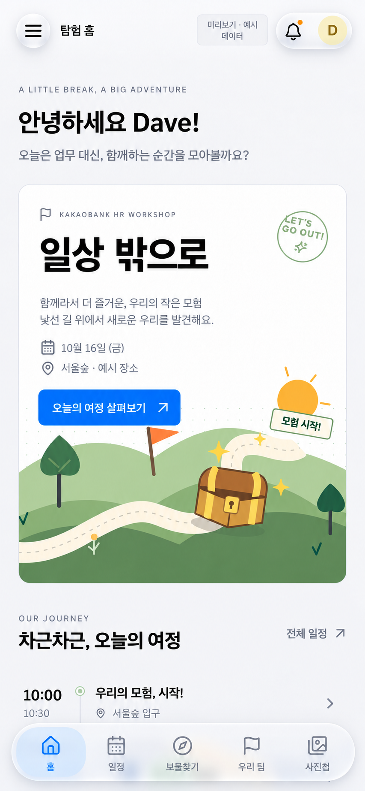

# 일상 밖으로 디자인 시스템

## Overview

**디자인 기준: 콘텐츠는 선명하게, 탐색 컨트롤은 가볍게 떠 있도록.**

워크샵 참가자가 일정, 보물찾기, 팀, 사진, 소식을 빠르게 확인하는 모바일 우선 PWA다. 최종 모바일 시안의 원형 메뉴 버튼, 알림·프로필 캡슐, 떠 있는 하단 탭을 앱 전체의 공통 탐색 언어로 사용한다. 본문은 밝은 회색 바탕, 불투명 흰색 표면, 또렷한 제목, 옐로우 바탕과 차콜 글자의 버튼으로 구성한다.

이 문서는 **합의된 시안을 실제 앱에 적용한 디자인 기준**이다. `src/main.tsx`에서 토큰·앱 스타일·공통 컴포넌트 스타일을 연결한다. 홈, 일정, 보물찾기, 팀, 사진첩, 소식, 프로필, 관리자 화면에 같은 색상과 UI 글꼴을 적용했다. 현재 포인트색은 **웜 옐로우 `#F5D547` + 차콜 `#1D1D1F`**이며, 기존 모바일 시안은 형태·배치의 기준으로 유지한다. 색상은 이 문서와 런타임 토큰이 시안보다 우선한다. 런타임 값의 단일 원본은 [tokens.css](src/design/tokens.css)다. 문서의 frontmatter는 식별 정보만 가진다.

| 파일                                                   | 역할                                                    |
| ------------------------------------------------------ | ------------------------------------------------------- |
| [최종 모바일 시안](docs/design/mobile-approved.png)    | 형태·분위기의 기준. 이전 v1/v2 시안보다 우선한다.       |
| [src/design/tokens.css](src/design/tokens.css)         | 색·글꼴·간격·형태·재질·동작·레이어의 공통 CSS 변수      |
| [src/design/primitives.css](src/design/primitives.css) | 버튼·유리 컨트롤·탭·입력·표면·배지의 선택적 적용 클래스 |
| [.impeccable/design.json](.impeccable/design.json)     | 문서 도구용 확장 메타데이터와 독립 컴포넌트 예제        |



### 유지할 것

- 화면별 정보 구조, 콘텐츠 순서, 메뉴 항목, 기능, 권한, 데이터와 문구.
- 홈의 인사말 → 배너 → 일정 → 보물찾기 → 공지 → 탐험 여권 → 팀 카드 순서와 기존 반응형 배치.
- `ExpeditionArt`의 숲·길·보물상자 일러스트, 실제 사진, 보물 이미지, 지도.
- 모바일 하단 메뉴 순서: **홈 / 일정 / 보물찾기 / 우리 팀 / 사진첩**. 소식은 기존 상단 알림과 전체 메뉴로 접근한다.
- 데스크톱의 사이드바와 홈의 본문·보조 열. 모바일용 캡슐 탭을 데스크톱에 새로 추가하지 않는다.

### 변경할 것

색상, 글꼴, 테두리, 그림자, 컨트롤 모양과 상태 표현을 통일한다. 상단 메뉴는 원형 유리 버튼, 알림·프로필은 하나의 유리 캡슐, 하단 탭은 가장자리에서 떨어진 캡슐로 만든다. 본문 버튼과 카드를 모두 유리로 바꾸지 않는다.

픽셀 값은 시안의 고해상도 이미지에서 그대로 복사한 치수가 아니라, 실제 CSS 픽셀과 터치·가독성 기준으로 정규화한 구현 값이다. 밝은 테마가 기준이며, 다크 테마는 이 문서에서 정의하지 않는다.

## Colors

새 컴포넌트는 `--ds-*` 의미 토큰을 사용한다. 색상 값의 복사나 상태·위치 색을 브랜드색으로 일괄 치환하는 방식은 피한다.

| 용도                              | 토큰                                                              | 값                                |
| --------------------------------- | ----------------------------------------------------------------- | --------------------------------- |
| 앱 바탕                           | `--ds-color-canvas`                                               | `#F5F5F7`                         |
| 본문 카드·입력·시트               | `--ds-color-surface`                                              | `#FFFFFF`                         |
| 보조 버튼·메타 배경               | `--ds-color-surface-subtle`                                       | `#EEEEF1`                         |
| 제목·본문                         | `--ds-color-text`                                                 | `#1D1D1F`                         |
| 설명·시간·장소                    | `--ds-color-text-secondary`                                       | `#6E6E73`                         |
| 유리 위 비선택 탐색 아이콘·라벨   | `--ds-glass-text`                                                 | `#14141B`                         |
| 주요 버튼 배경                    | `--ds-color-action`                                               | `#F5D547`                         |
| 주요 버튼 글자 / 링크·선택 아이콘 | `--ds-color-on-action` / `--ds-color-action-text`                   | `#1D1D1F`                         |
| 버튼 hover / pressed             | `--ds-color-action-hover` / `--ds-color-action-pressed`            | `#E8C632` / `#D8B624`              |
| 키보드 포커스 / 작은 선택 컨트롤 | `--ds-color-focus`                                                | `#756000`                         |
| 지도 내 위치·나침반 방향          | `--ds-color-location`                                             | `#007AFF`                         |
| 보물·보상 강조                    | `--ds-color-accent`                                               | `#F5D547`                         |
| 선택된 탭의 배경                  | `--ds-glass-selected-bg`                                          | `rgb(250 226 133 / 82%)`          |
| 선택된 탭의 글자·아이콘           | `--ds-glass-selected-text`                                        | `#1D1D1F`                         |
| 불투명 선택 표면 / 유리 대체 표면 | `--ds-color-selected`                                             | `#FFF3BF`                         |
| 구분선 / 카드 테두리              | `--ds-color-separator` / `--ds-color-border`                      | `#DEDEE3` / `#D9D9DF`             |
| 입력 경계                         | `--ds-color-border-input`                                         | `#86868B`                         |
| 성공 / 경고 / 오류                | `--ds-color-success` / `--ds-color-warning` / `--ds-color-danger` | `#237647` / `#805500` / `#B42318` |
| 프로필 아바타                     | `--ds-color-avatar-bg` / `--ds-color-avatar-text`                 | `#FBF0BF` / `#745B17`             |
| 홈 보물찾기 배너                  | `--ds-color-feature-bg`                                           | `#242426`                         |

### 브랜드·위치·상태 색의 역할

지도에서 내 위치 점·방향 화살표·GPS 오차 반경·내 위치 범례는 `--ds-color-location`(`#007AFF`)으로 통일한다. 관리자 배치 지도의 내 위치도 같은 토큰을 사용한다. SDK에 그리는 GPS 오차 원에는 CSS 변수의 계산된 색상을 전달한다. 초록색은 방향 일치·성공 등 상태 의미로 구분한다.

주요 버튼은 옐로우 배경과 차콜 라벨을 짝지어 사용한다. 링크·선택 아이콘·입력 커서는 `action-text`로 분리해 밝은 노란 글자가 흰 바탕에 놓이지 않도록 한다. 차콜과 기본 버튼의 대비는 **11.61:1**, 누른 버튼은 **8.52:1**, 불투명 선택 배경은 **15.09:1**이다. 키보드 포커스와 작은 선택 컨트롤에는 짙은 골드 `#756000`을 사용한다. 삭제 버튼과 방향 일치 체크는 각각 `on-danger`, `on-success`의 흰 글자를 유지한다. 계산은 불투명 sRGB 색 조합 기준이며 유리 위 글자는 실제 합성 배경에서도 별도로 확인한다.

기존 일러스트·아바타의 색은 보존한다. 옐로우는 주요 동작과 보물 아이콘에, 옅은 노랑은 선택 표면에 사용한다. 내 위치 파랑은 브랜드 토큰과 독립적으로 유지한다. 성공 상태, 팀 색, 현금 보물, 경고의 의미를 서로 바꾸지 않는다. 상태는 색과 함께 아이콘·문구로 표시한다. `[aria-invalid]`, 선택 표시, 비활성 상태를 색상 하나로만 구분하지 않는다.

## Typography

Apple 기기에서는 시스템 UI 글꼴을, 다른 환경에서는 프로젝트에 이미 있는 `Noto Sans KR`을 사용한다. 이 선택은 사용자가 지정한 Apple 스타일에 따른 것이다. SF 폰트 파일을 임의로 내려받거나 번들에 추가하지 않는다.

```css
font-family: var(--ds-font-ui);
/* -apple-system, BlinkMacSystemFont, "Apple SD Gothic Neo",
   "Noto Sans KR", "Segoe UI", sans-serif */
```

| 역할                | 크기 토큰               | 기본 크기 / 굵기 / 행간      |
| ------------------- | ----------------------- | ---------------------------- |
| 홈 배너 제목        | `hero` / `hero-desktop` | 40 / 48px, 700, 1.15         |
| 페이지 인사·제목    | `page`                  | 24px, 700, 1.3               |
| 섹션 제목           | `section`               | 20px, 600–700, 1.3           |
| 카드 제목           | `title`                 | 18px, 600, 1.3               |
| 본문·주요 버튼      | `body`                  | 15px, 400 / 600, 1.65 / 1.4  |
| 입력 필드           | `input`                 | 16px, 400, 1.4               |
| 일반 라벨           | `label`                 | 13px, 500, 1.4               |
| 설명·메타           | `caption`               | 12px, 400, 1.4               |
| 하단 탭             | `tab`                   | 11px, 500 / 선택 시 600, 1.4 |
| 기존 영문 보조 표기 | `micro`                 | 10px, 600, 1.4               |

표의 크기 토큰 접두사는 `--ds-font-size-`다. 기존 루트 글자 크기가 14px이므로 토큰은 CSS px로 정의해 의도치 않은 축소를 막는다. 브라우저 확대를 제한하지 않고, 텍스트가 커지면 컨테이너 높이가 늘어나게 한다.

- `Jua`는 새 UI 제목·버튼·숫자에서 제거한다. 기존 일러스트 내부 문자와 로고는 보존한다.
- 제목 자간은 `--ds-letter-spacing-heading`(-0.025em), 본문은 -0.01em. 한국어 장문은 자연스럽게 줄바꿈하고, 긴 아이디·URL에는 `overflow-wrap: anywhere`를 사용한다.
- 시간·점수는 `font-variant-numeric: tabular-nums`. 코드·식별자에만 mono를 쓴다.
- 기존 영문 eyebrow는 유지하되 새 화면마다 장식용 문구를 추가하지 않는다. 정보의 우선순위는 제목·간격으로 만든다.
- 중요한 도움말·오류·상태를 micro/tab 크기로 축소하지 않는다. 시안 한 화면에 맞추려고 글자를 줄이지 않는다.

## Layout

전체 구조는 기존 `src/styles.css`의 반응형 동작을 유지한다. 모바일 원본은 390px 기준이며, **320·390·430·768·1024·1440px**에서 확인한다.

| 기존 구간           | 유지할 배치                                     |
| ------------------- | ----------------------------------------------- |
| `max-width: 760px`  | 모바일, 본문 좌우 20px, 상단 65px, 하단 캡슐 탭 |
| 761–1000px          | 사이드바 185px, 기존 홈 열 재배치               |
| 1001–1190px         | 사이드바 205px, 기존 좁은 데스크톱 배치         |
| 1191px 이상         | 사이드바 232px, 상단 80px, 본문·보조 열         |
| `min-width: 1500px` | 기존 넓은 화면 조정 유지                        |

600·540·480px 등의 컴포넌트 전용 분기는 목적을 확인한 뒤 유지한다. CSS 변수는 일반 미디어 쿼리 조건에 사용할 수 없으므로 `@media (max-width: var(...))`를 만들지 않는다.

간격 스케일은 **2 / 4 / 6 / 8 / 12 / 16 / 20 / 24 / 32 / 40 / 48 / 64px**다. 한 컨트롤 안은 4–8px, 관련 요소 사이는 12–16px, 카드 내부는 20px, 섹션 사이는 24–32px를 우선한다. 기존 화면을 동일 크기 카드 그리드로 재편하지 않는다.

### 떠 있는 탐색 영역

- 상단: 44px 원형 메뉴 버튼, 일반 텍스트 제목, 일반 미리보기 배지, 알림·프로필을 묶은 캡슐. 알림과 프로필은 각각 독립된 클릭 대상으로 유지한다.
- 하단: 좌우 12px, 아래 `10px + safe-area-inset-bottom`, 최소 높이 64px, 내부 padding 4px. 다섯 항목을 균등 배치한다.
- 화면 전체 폭의 배경 띠와 위쪽 구분선을 제거한다. 캡슐 주변으로 페이지 바탕이 보여야 한다.
- 본문 하단 여유 공간은 `--ds-nav-reserved-space`를 사용한다. 탭이 확대 글꼴로 높아지면 `ResizeObserver`로 실제 높이를 `document.documentElement`의 `--ds-measured-tabbar-height`에 기록한다.
- 모바일에서 `scroll-padding-bottom`과 마지막 입력·일정·버튼의 가림을 확인한다. 가로 화면은 좌우 safe area도 반영한다.
- 데스크톱은 기존 사이드바를 유지하며 선택 항목에 연한 노란 표면을 쓴다. 메뉴 수를 줄이거나 하단 탭을 중복 노출하지 않는다.

## Elevation & Depth

깊이는 콘텐츠 위에 떠 있는 **조작 영역의 역할**을 알리는 데 사용한다. Apple은 Liquid Glass를 콘텐츠와 구별되는 탐색·조작 레이어에 제한적으로 사용하도록 안내한다. 이 웹 구현은 그 원칙을 따르는 시각적 근사이며, CSS blur가 네이티브의 동적 굴절·물성 전체를 재현한다고 주장하지 않는다. [Apple Materials](https://developer.apple.com/design/human-interface-guidelines/materials), [Apple navigation overview](https://developer.apple.com/documentation/technologyoverviews/adopting-liquid-glass).

| 영역                                             | 재질                                       |
| ------------------------------------------------ | ------------------------------------------ |
| 모바일 메뉴 원형 버튼                            | `.ds-icon-button.ds-glass`                 |
| 알림·프로필 묶음                                 | 바깥 `.ds-control-group.ds-glass`에만 적용 |
| 모바일 하단 캡슐                                 | `.ds-tabbar.ds-glass`                      |
| 지도·사진 위 닫기/위치 컨트롤                    | 필요한 작은 독립 그룹에만 적용 가능        |
| 주요·보조·삭제 버튼, 폼 제출                     | 불투명 단색                                |
| 배너, 일정, 공지, 여권, 팀 카드, 입력, 관리자 표 | 불투명 표면                                |
| 모달·드로어 본문                                 | 불투명 흰색과 해당 레이어 그림자           |
| 미리보기·팀·상태 배지                            | 일반 단색 배경                             |

### 유리 토큰

`--ds-glass-bg`는 흰색 50%, filter는 `blur(10px) saturate(1.65)`다. 배경이 더 비치도록 선택 캡슐도 82%로 낮추고, 유리 위 라벨은 `#14141B`로 진하게 유지한다. `--ds-glass-sheen`은 약한 면 반사, `--ds-glass-edge`는 마스크로 제한한 1px 가장자리 반사다. 내용과 포커스 링은 자르지 않는다. 작은 아래 그림자와 밝고 어두운 안쪽 경계로 두께를 표현한다. 이 값은 네이티브 소재의 공식 수치가 아니라 이 앱의 구현값이다.

모바일 상단 바 자체는 투명하다. 원형 메뉴와 알림·프로필 캡슐이 실제 뒤쪽 콘텐츠를 샘플링하도록, 부모에 불투명 바탕이나 blur를 겹치지 않는다. 페이지 제목에는 작은 불투명에 가까운 읽기용 배경을 둔다. 고대비·투명도 감소·필터 미지원 환경에서는 반사 레이어를 제거하고 흰색 표면으로 대체한다.

하단의 선택 표시는 `.ds-tab-indicator` 하나다. `App.tsx`가 현재 페이지에 맞는 `--ds-active-index`를 설정하고, 같은 캡슐을 이동시킨다. 각 버튼의 배경을 별도로 페이드해 두 항목이 선택된 것처럼 보이게 하지 않는다. 소식·프로필·관리자처럼 하단에 없는 페이지에서는 표시를 숨긴다.

- 한 그룹의 바깥 표면에만 blur를 적용한다. 내부 버튼에 유리를 중첩하지 않는다.
- 본문 카드의 그림자는 `none`; 팝오버와 모달은 각각 `--ds-shadow-popover`, `--ds-shadow-modal`을 쓴다.
- 움직이는 지도·사진 위에서도 글자가 읽혀야 한다. 부족하면 불투명 대체 표면을 사용한다.
- blur·box-shadow를 스크롤마다 애니메이션하지 않는다. 캔버스 굴절, SVG 왜곡 필터, WebGL 효과를 기본 요구사항으로 추가하지 않는다.
- `backdrop-filter`와 `-webkit-backdrop-filter`를 함께 선언한다. 미지원 환경은 토큰 파일에서 불투명 흰색으로 대체한다.

### 접근성·동작

`prefers-reduced-transparency: reduce`, `prefers-contrast: more`, `forced-colors: active`에 대응한다. 투명도 환경설정의 브라우저 지원을 가정하지 않고, `<html data-reduce-transparency="true">`로도 불투명 표면을 선택할 수 있다. 이 속성의 저장·설정 UI는 토큰 자체가 제공하지 않는다.

상태 전환은 120ms, 일반 전환은 180ms, 패널은 240ms. 하단 선택 캡슐은 320ms와 `--ds-ease-selection`으로 약하게 탄성을 주며 이동한다. 원형 조작 버튼은 누르는 동안 0.96배로 반응한다. `background-color`, `color`, `border-color`, 선택 캡슐·패널의 `transform`·`opacity`만 전환한다. `transition: all`, 반복 펄스, 모든 카드의 등장 애니메이션을 추가하지 않는다. `prefers-reduced-motion`에서는 전환 시간과 누름 크기 변화를 제거한다. [Apple의 소재·상호작용 설명](https://developer.apple.com/videos/play/wwdc2025/219/)을 참고한 웹 근사 구현이며, 실제 배경 굴절을 재현하는 셰이더는 포함하지 않는다.

일반 글자 대비 목표는 4.5:1, 큰 글자는 3:1이다. 본 프로젝트의 터치 목표는 **44×44 CSS px 이상**이다. 이는 WCAG 2.2 AA의 24px 최소 규칙보다 여유 있는 제품 기준이다. focus-visible은 3px 짙은 골드 outline과 3px offset을 사용하며 잘라내지 않는다. [WCAG contrast](https://www.w3.org/WAI/WCAG22/Understanding/contrast-minimum.html), [WCAG target size](https://www.w3.org/WAI/WCAG22/Understanding/target-size-minimum.html).

레이어는 본문 0, 상단 40, 탭 60, 백드롭 70, 드로어 80, 모달 100, 토스트 110을 기본으로 한다. 기존 `<dialog>`의 top layer와 focus trap을 유지한다. CSS z-index만으로 네이티브 dialog 위에 알림이 표시된다고 가정하지 않는다.

## Shapes

| 요소                           | 형태       |
| ------------------------------ | ---------- |
| 메타 배지                      | 6px        |
| 일반 버튼·입력                 | 10px       |
| 콘텐츠 카드·배너               | 16px       |
| 시트 상단 모서리               | 24px       |
| 메뉴 버튼·프로필               | 원형       |
| 상단 조작 그룹·하단 탭·선택 탭 | 999px 캡슐 |

캡슐은 탐색 컨트롤을 구분하는 형태다. 모든 카드·폼 버튼에 적용하지 않는다. 하단 선택 항목은 큰 사각 타일이나 빛나는 독립 풍선이 아니라, 캡슐 안의 연한 타원형 표면이다. 여권의 티켓 절취선·바코드와 일러스트의 고유 형태는 유지한다.

## Components

### Buttons

`.ds-button`은 44px 이상, 10px radius, 단색 action 옐로우 배경, 차콜 라벨이다. `.ds-button--secondary`, `--ghost`, `--danger`를 지원한다. 본문 버튼에는 `.ds-glass`를 붙이지 않는다.

| 상태        | 규칙                                                                    |
| ----------- | ----------------------------------------------------------------------- |
| hover       | 포인터 환경에서만 의미 토큰의 hover 색상                                |
| pressed     | pressed 색상, 크기 변화·발광 없음                                       |
| focus       | 키보드용 외곽 outline; hover와 독립                                     |
| disabled    | 명시적 회색 배경·글자, `disabled` 사용, 전체 opacity로 흐리게 하지 않음 |
| loading     | 원래 너비 유지, `aria-busy="true"`, 재실행 방지; 처리 중 문구/상태 안내 |
| destructive | danger 색과 명확한 동작명; 기존 확인 동작 유지                          |

### Navigation

아이콘은 기존 `lucide-react`를 사용한다. 20–22px, stroke 1.75를 기본으로 통일한다. SF Symbols 이미지나 이모지를 웹 UI에 복사하지 않는다.

상단의 알림·프로필을 같은 **시각적 그룹**으로 묶되 하나의 버튼으로 합치지 않는다. 각 아이콘 버튼은 기존 `aria-label`, 알림 배지, 메뉴 `aria-expanded`·`aria-controls`, 프로필 진입 동작을 보존한다. 미리보기 배지는 유리 그룹 밖에 둔다.

페이지 이동용 하단 바는 `<nav aria-label="모바일 메뉴">`와 기존 링크/버튼을 사용한다. 선택은 `aria-current="page"`로 표시한다. 패널 전환 위젯이 아니므로 모양 때문에 `role="tablist"`로 바꾸지 않는다. 확대 글자에서 아이콘이나 라벨을 숨기지 않는다.

### 나침반

지도 안내와 확대 화면은 `CompassDial`의 원형 눈금·방위·보물 바늘을 공유한다. 정면 기준 표식은 고정하고 북쪽 눈금과 바늘만 센서·기존 안내값에 맞춰 회전시킨다. 계기판과 본문에는 유리를 적용하지 않는다. 기본 본문은 중립색, 바늘은 action 색, 방향 일치와 근접 상태는 success 색을 사용한다. 20° 일치 판정과 GPS 기반 대략적 거리 규칙은 유지한다. 센서가 끊기면 바늘을 숨기고 재연결 버튼을 제공한다. 자세한 상태 규칙은 [큰 방향 안내](docs/direction-focus.md)를 따른다.

### Inputs, surfaces, chips

- `.ds-input`: 16px 글자, 44px 이상, 흰 바탕과 구분 가능한 테두리. 오류는 `aria-invalid`와 연결된 오류 설명을 함께 제공한다. placeholder가 label을 대신하지 않는다.
- `.ds-surface`: 흰색·16px 모서리·얇은 경계·20px padding, 그림자 없음. 일정과 공지를 전부 개별 카드로 감싸지 않는다.
- `.ds-chip`: 일반 메타 배지. 인터랙티브 필터는 별도 44px 터치 영역과 선택 상태가 필요하다.
- 빈 상태, 불러오는 중, 권한 오류는 해당 콘텐츠 위치에 표시한다. 읽기 쉬운 문구와 실제 재시도·설정 동작을 유지한다.

### 화면별 적용 범위

| 화면 / 파일                      | 적용 기준                                                                              |
| -------------------------------- | -------------------------------------------------------------------------------------- |
| `App.tsx`                        | 상단 원형/그룹 컨트롤, 모바일 캡슐 탭, 데스크톱 사이드바 선택 스타일                   |
| `Home.tsx`                       | 배너·일러스트·배치 유지, 타이포·표면 교체, 보물찾기 배너 charcoal, 여권과 팀 카드 흰색 |
| `Timeline.tsx`                   | 기존 날짜 탭·시간축 유지, 선택은 action/selected, 목록은 일반 표면                     |
| `Treasure.tsx`, 지도·나침반      | 지도·보물 비공개 규칙·센서 UI 유지, 떠 있는 도구만 유리; 열감/방향 상태 색은 의미 유지 |
| `Team.tsx`, `ActivityGroups.tsx` | 순위·팀 색·기여도 구조 유지, 공통 텍스트/표면 토큰                                     |
| `PhotoBoard.tsx`, 사진 피드·뷰어 | 사진·댓글 배치 유지, 게시 버튼 단색, 사진 위 닫기 도구만 유리 가능                     |
| `Notices.tsx`                    | 공지·읽음·대상 구분 유지, 일반 행/본문과 링크 토큰                                     |
| `Profile.tsx`                    | 프로필·설정 행 유지, 알림 권한 상태를 단순 색으로 대체하지 않음                        |
| `Admin.tsx`, 관리자·보물 관리    | 표·검색·폼·확인 흐름 유지, 밀도와 파괴적 액션 우선, 장식 유리 없음                     |
| `common.tsx`, 드로어·탐색 dialog | 기존 키보드·포커스·스크롤 잠금 유지, 불투명 본문과 제한된 조작부                       |

### 적용 방법

보물찾기의 확대 지도·나침반 헤더, AR 닫기, 가이드·발견 결과 닫기에도 공통 원형 유리 컨트롤을 사용한다. 지도 확대·축소·현재 위치는 하나의 세로 유리 캡슐로 묶고 각 버튼은 44px을 유지한다. AR 준비 화면은 불투명 흰색이며, 실제 카메라 영상 위의 안내 대비와 방향 일치 시 초록색 표시는 유지한다.

1. `src/main.tsx`의 스타일 import는 다음 순서로 연결되어 있다. 새 전역 스타일을 추가할 때도 이 순서를 유지한다.

   ```tsx
   import "./design/tokens.css";
   import "./styles.css";
   import "./design/primitives.css";
   ```

2. 기존 전역 변수부터 아래처럼 역할에 맞춰 연결한다. `--green`, `--yellow`, `--orange`는 일괄 별칭으로 만들지 않는다.

   | 기존 값                 | 새 값                            |
   | ----------------------- | -------------------------------- |
   | `--paper`               | `var(--ds-color-canvas)`         |
   | `--surface`             | `var(--ds-color-surface)`        |
   | `--ink`                 | `var(--ds-color-text)`           |
   | `--muted`               | `var(--ds-color-text-secondary)` |
   | `--line`                | `var(--ds-color-separator)`      |
   | `--radius`              | `var(--ds-radius-surface)`       |
   | 주요 버튼의 기존 초록   | `var(--ds-color-action)`         |
   | 성공 의미의 기존 초록   | `var(--ds-color-success)`        |
   | 팀/일러스트의 초록·노랑 | 기존 콘텐츠 색 유지              |

3. 본문은 `--ds-font-ui`, 제목은 `--ds-font-display`를 사용한다. 루트의 14px 자체를 무조건 변경하지 않는다. `Jua`는 기존 `ExpeditionArt`의 그림 속 표지판에만 남겨 import를 유지한다. 일반 UI에는 사용하지 않는다.
4. 공통 버튼·입력부터 예제 클래스를 적용한다. 클래스만 추가하고 기존 `.hero .button`, `.button.dark`, 모바일 미디어 쿼리의 하드코딩을 남기면 충돌할 수 있다. 같은 역할의 기존 선언을 함께 정리한다.
5. 상단 알림·프로필에 공유 컨테이너를 만들고, 하단에 `ds-tabbar ds-tabbar--fixed ds-glass`, 각 항목에 `ds-tab`을 붙인다. 모바일에서만 표시하는 기존 분기를 유지한다.
6. 모바일 본문은 `padding-bottom: var(--ds-nav-reserved-space)`를 사용한다. `useNavigationInsets`가 상단·하단의 실제 높이를 측정해 글자 확대와 safe area에 대응한다. 메뉴 드로어의 `inset`, 배경 차단과 포커스 복귀도 함께 유지한다.
7. 각 화면의 의미별 색·표면을 순차 전환한다. 일반 본문은 불투명 표면으로 유지한다. 새 규칙마다 더 강한 선택자를 덧붙이는 대신 기존 규칙을 정리한다.

```tsx
// 형태 예제. 이벤트·권한·알림 로직은 기존 컴포넌트에서 유지한다.
<button className="ds-icon-button ds-glass" aria-label="전체 메뉴">
  <Menu aria-hidden="true" />
</button>
<div className="ds-control-group ds-glass">
  <button className="ds-icon-button" aria-label="새로운 소식 보기">
    <Bell aria-hidden="true" />
  </button>
  <button className="ds-icon-button" aria-label="내 프로필 보기">
    <Avatar name="Dave" />
  </button>
</div>
<button className="ds-button">오늘의 여정 살펴보기</button>
```

### 검수 기준

- 새 토큰으로 바꾼 화면을 모바일과 데스크톱에서 직접 확인한다. 스크린샷이 예뻐 보여도 메뉴 항목·기능 누락을 허용하지 않는다.
- 320px에서 다섯 탭 라벨이 들어가고, 200% 확대에서 콘텐츠를 읽고 조작할 수 있어야 한다. 고정 높이로 글자를 자르지 않는다.
- 키보드 순서, 포커스 표시, 메뉴 열고 닫기, dialog 포커스 복귀, 마지막 행/버튼 접근을 확인한다.
- 투명도 감소·동작 감소·강제 색상·blur 미지원의 대체 표면을 확인한다. 지도·사진 위에서도 대비를 확인한다.
- 실제 기능 변경이 있을 때만 해당 흐름의 테스트를 추가한다. 문서·토큰 도입만으로 Firebase/위치/푸시 로직을 수정하지 않는다.

## Do's and Don'ts

### Do

- 기존 정보 구조와 기능을 보존하고 최종 v3 시안의 탐색 컨트롤 형태를 따른다.
- 같은 역할은 같은 의미 토큰으로 표현한다. 새 값은 `tokens.css`에 먼저 정의한다.
- 원형·캡슐·일반 사각 버튼을 역할에 따라 구분한다.
- 유리의 가독성이 떨어지면 불투명 대체 표면을 우선한다.
- 긴 이름, 빈 일정, 긴 공지, 로딩·오류·비활성 상태로 확인한다.

### Don't

- 모든 버튼·카드·배지에 Liquid Glass를 적용하지 않는다.
- 두꺼운 흰 테두리, 이중 유리 림, 파란 발광, 플라스틱 광택을 추가하지 않는다.
- 본문 CTA에 그라데이션·굴절·blur를 넣지 않는다.
- 상단 전체를 거대한 유리 캡슐로 감싸거나 하단 캡슐 뒤에 전체 폭 배경 띠를 남기지 않는다.
- 시안 이미지의 작은 글자를 그대로 CSS 크기로 옮기거나 글자 확대를 막지 않는다.
- 브랜드 일러스트를 사진으로 바꾸거나 홈 구성·메뉴 수·콘텐츠 문구를 임의로 바꾸지 않는다.
